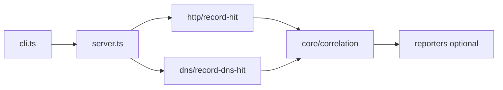

# hx-callback-cli — architecture

## Purpose

Hosts a lightweight OOB callback service: HTTP requests and DNS queries are recorded
with correlation metadata for blind vulnerability confirmation. Non-goals: TLS
termination, persistent storage, or multi-tenant SaaS hosting.

## High-level flow

## Module map

| Path                                | Responsibility                                   |
| ----------------------------------- | ------------------------------------------------ |
| `src/cli.ts`                        | Commander `listen`, port flags, hit polling loop |
| `src/server.ts`                     | Start/stop HTTP + DNS servers, hit queue API     |
| `src/core/start-callback-server.ts` | Bind listeners, expose `baseUrl`                 |
| `src/core/correlation.ts`           | Path/token generation for payloads               |
| `src/http/record-hit.ts`            | Parse incoming HTTP into `CallbackHit`           |
| `src/dns/record-dns-hit.ts`         | Decode DNS query labels                          |
| `src/analysis/summarize-hits.ts`    | Aggregate stats (tests / future JSON export)     |
| `src/reporters/`                    | JSON/table helpers                               |
| `src/utils/`                        | Header normalization, body truncation            |

## Extension

1. Add a channel handler (e.g. SMTP) under `src/` and wire into `server.ts`.
2. Persist hits to disk with a new reporter — keep default listen mode ephemeral.
3. Unit-test recording and correlation with mocked `IncomingMessage` — no live ports in
   unit tests.
4. Run `npm test` and `npm run format:check`.

## Testing strategy

- **Unit**: correlation, record-hit, headers, truncation (`*.spec.ts`).
- **Integration**: `tests/server.test.ts` exercises server lifecycle with ephemeral
  ports.

## Ethics & scope

Authorized engagements only. See [SECURITY.md](./SECURITY.md).
